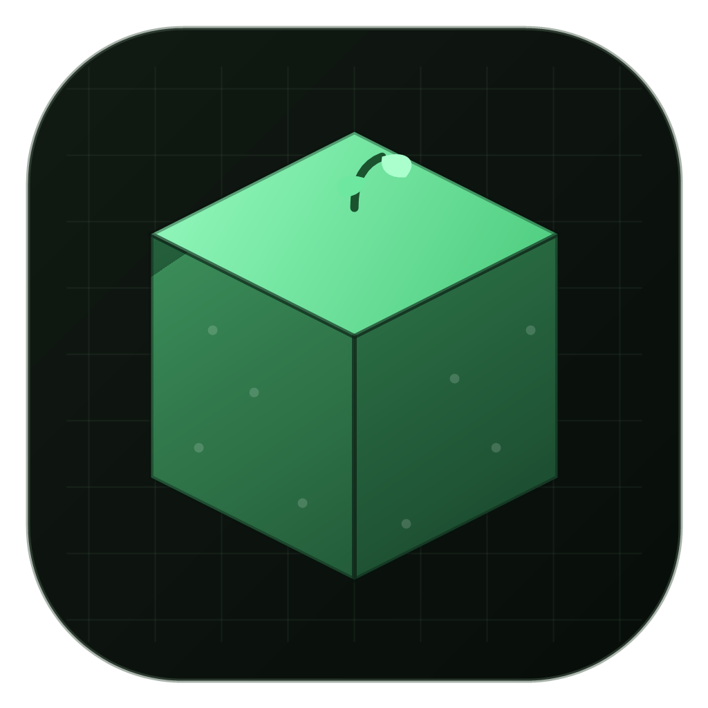
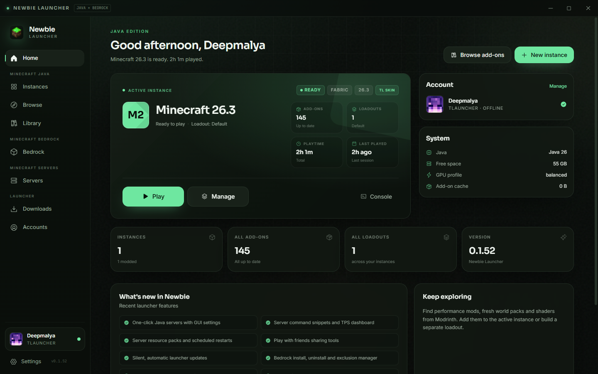
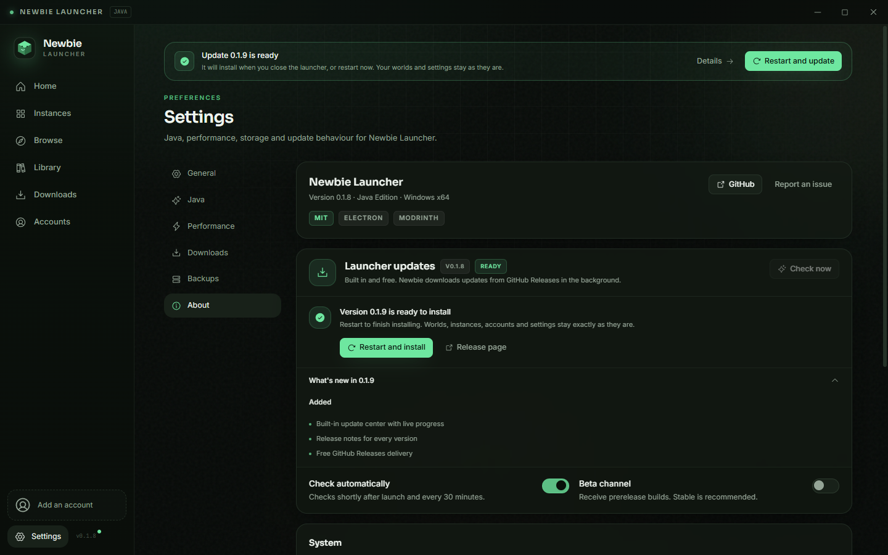
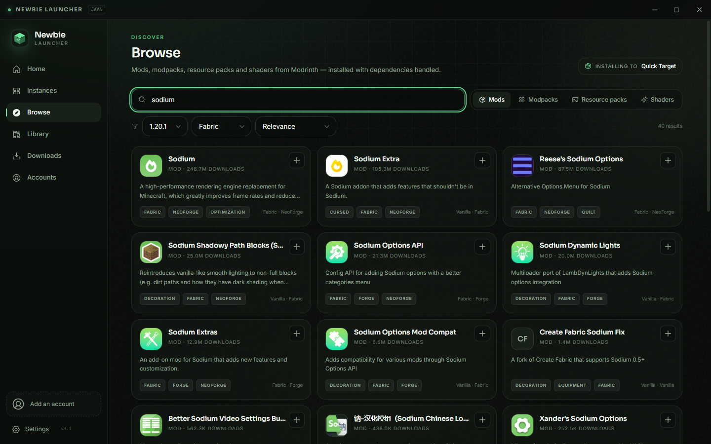
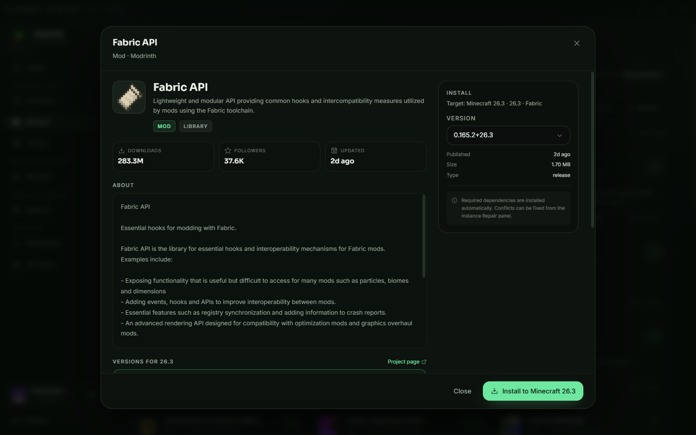
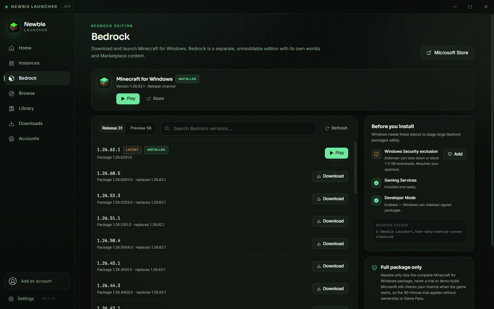

# Newbie Launcher

<p align="center">
  
</p>

A calm, stable Minecraft **Java Edition** and **Bedrock (Minecraft for Windows)** launcher with one-click local servers — built around the things that actually break modded play: Java versions, loader installs, conflicting mods, pack drift, and losing a world.

<p align="center">
  
</p>

> Java and Bedrock are kept separate. Java supports mods, loadouts and Modrinth; Bedrock is the official Minecraft for Windows package and is not moddable.

## Download

Installers are published on the [Releases](https://github.com/Deepma1ya/Newbie-Launcher/releases) page.

- Windows 10/11, x64
- Per-user install; the installer lets you choose the install folder
- Built-in auto-updates over the public GitHub Releases feed — no update server, account or paid service. Checks at startup and every 30 minutes, downloads in the background with live progress, shows release notes, and installs silently and automatically once it is safe to restart.

<p align="center">
  
</p>

## What it does

| Area | What Newbie handles |
| --- | --- |
| **Game versions** | Every Mojang release, snapshot, beta and alpha, installed from official metadata and verified files |
| **Bedrock** | Minecraft for Windows versions: download official signed GDK packages, install through Windows/Gaming Services, launch the installed package, and switch versions without touching Java |
| **Loaders** | Vanilla, Fabric, Quilt, Forge and NeoForge. Forge/NeoForge run the official installer and capture its result |
| **Servers** | One-click local Vanilla, Paper, Fabric, Quilt, Forge and NeoForge servers with a live console, GUI settings and Modrinth plugins, mods and datapacks |
| **Java** | Detects installed JDKs/JREs, then downloads Eclipse Temurin JRE 8/11/17/21/25 from Adoptium when a version needs it |
| **Accounts** | Microsoft OAuth sign-in, TLauncher nickname + official TLSkinCape plugin, offline profiles, and generic authlib/Yggdrasil servers |
| **Browse** | Modrinth. Use the `+` button to install straight into the selected instance, with dependencies resolved. Modpacks install as new instances or into a matching existing instance. No API key required. |
| **Datapacks** | Modrinth datapacks installed directly into a chosen world's `datapacks` folder, or kept in an instance staging folder. Required dependencies and updates follow the same target. |
| **Settings transfer** | Copy keybinds, video/audio options, resource pack order and Iris shader setup between instances, or make the selected settings the default for every other instance. |
| **Loadouts** | Named add-on sets with **full offline backup** or **download on switch** storage modes |
| **Updating** | Check and update mods, resource packs and shaders in one click; version changes carry add-ons forward |
| **Repair** | Installs missing dependencies and re-enables disabled providers first. Essential mods such as Fabric API and Sodium are protected from conflict disables. Other duplicate, wrong-loader or incompatible mods are only disabled after a confirmation popup, with a backup |
| **Launcher updates** | Built-in updater over free GitHub Releases: background download, live progress and speed, release notes, restart-and-install, stable or beta channel |
| **Backups** | World ZIPs before launch, with retention and size limits |
| **Performance** | Balanced/FPS/Quality profiles written to `options.txt`, plus the Windows high-performance GPU preference for Java |
| **Comfort** | Custom install location, close-to-tray, live console, crash hints, auto-updater |

<p align="center">
  
  
</p>

## Updates

Newbie updates itself through the public GitHub Releases feed. There is no update server to run and no account or paid service involved.

- **Settings → About → Launcher updates** shows the installed version, update status, live download progress and speed, and release notes.
- Automatic checks run shortly after launch and every 30 minutes. You can turn them off or enable the beta channel in the same panel.
- Downloads happen in the background from GitHub. The installer is verifiable against the SHA-512 in `latest.yml`.
- **Silent, automatic installation.** When a download finishes, Newbie restarts itself and runs the installer with no Next/Next pages. If Minecraft, a local server or a launcher task is still running, installation waits until that finishes. The updated launcher opens again by itself.
- **Install now** is available if you do not want to wait for an active game, server or task to finish. Fresh installs still let you choose the installation folder; updates never show the installer wizard.
- Worlds, instances, accounts, servers and settings are untouched.
- The sidebar version chip and the in-app banner show when an update is available or ready to install.

## Bedrock

The **Bedrock** page downloads and launches Minecraft for Windows separately from Java instances.

- Lists release and preview builds from the public MIT-licensed [GdkLinks](https://github.com/MinecraftBedrockArchiver/GdkLinks) catalog.
- Downloads the full Microsoft-signed GDK package with progress, resume and cancel.
- Installs through Windows/Gaming Services with `Add-AppxPackage`. A different version replaces the installed package; Windows preserves worlds and settings.
- Launches the installed package through its real Windows app identity.
- Requires a Microsoft account with **Minecraft for Windows** or **Game Pass**. The full package is listed; the in-game 90-minute trial still applies if the account does not own the game. Newbie does not bypass licensing.
- Bedrock is not moddable. Modrinth, loadouts, shaders and repair are Java-only.

<p align="center">
  
</p>

### Windows Security exclusion

Defender can slow down or block a 1–2 GB package. Before the first Bedrock download, Newbie asks for consent in the app, then opens a Windows UAC prompt.

Only these are excluded:

- Newbie's own Bedrock download folder
- The official `Microsoft.MinecraftUWP` / `Microsoft.MinecraftWindowsBeta` data folders
- The installed Microsoft package folders

Third-party DLLs, online fixes or cracks are never excluded. Newbie does not support them.

## Local servers

The **Servers** page creates and runs Minecraft servers on this PC. It is a launcher-managed alternative to downloading a server jar and editing text files by hand.

- **Six server types:** Vanilla, Paper, Fabric, Quilt, Forge and NeoForge.
- **Create & start** downloads the server software, prepares the Java runtime named in the Minecraft version metadata, writes a starter configuration, writes `eula=true` only after you tick the EULA checkbox, and starts the server.
- **Start, stop and restart** from the server list or the server page. Status is live, and servers are stopped gracefully when you quit or relaunch Newbie.
- **Settings** are switches, selectors and number fields: MOTD, port, player limit, game mode, difficulty, hardcore, PvP, flight, command blocks, the Nether, spawn protection, world name/seed/type, structures, mob spawning, view/simulation distance, compression, idle timeout, chunk writes, native transport, watchdog, entity range, online mode, whitelist, proxy/secure-profile checks, RCON and permission levels.
- **Runtime settings** let you rename the server and change its memory allocation without recreating it.
- **Live console** with launcher-captured logs, server command input and quick commands.
- **Add-ons from Modrinth:** plugins for Paper, mods for modded servers, datapacks for every type. Required dependencies are installed automatically, add-ons can be enabled/disabled without deleting them, and **Check updates → Update** replaces every outdated file in one click while preserving disabled state.
- Datapacks go into the active world's `datapacks` folder, so they keep working after the world folder is renamed.

Servers are stored under `<dataDir>/servers/<id>`. Each folder contains `server.json`, `server.properties`, the installed software, the world, add-on folders and logs. Newbie keeps its captured console in `logs/launcher-console.log` so it does not compete with Minecraft's own `logs/latest.log`.

## Accounts, honestly

- **Microsoft** — opens Microsoft's real sign-in page in an embedded window. The resulting Minecraft token is used for licensed servers. Tokens are encrypted with Windows DPAPI via Electron `safeStorage` and never reach the UI process.
- **TLauncher** — stores your public TLauncher nickname and syncs your public skin/cape from `auth.tlauncher.org`. TLauncher does not issue Mojang/Microsoft game licences, so these profiles play in offline mode. In-game TLauncher skin rendering is on the roadmap; the launcher avatar sync is implemented.
- **Offline** — a local username for single-player, LAN and offline-mode servers. You can upload a custom skin from the Accounts page; the launcher converts PNG, JPEG, WebP, BMP, GIF or TIFF images and applies it to the default player model through a local resource pack. Other players on servers will see the normal offline skin.
- **Authlib** — third-party Yggdrasil servers (Ely.by, LittleSkin, private servers). The API root is resolved with the standard ALI header.

Online-mode servers require Microsoft. This is a Minecraft platform rule, not a launcher restriction.

## Loadouts

A loadout is a saved set of add-ons. Switching loadouts moves the managed files into or out of the instance's `mods`, `resourcepacks` and `shaderpacks` folders.

- **Full offline backup** keeps a copy of every file in `cache/addons`. Switching works without internet.
- **Download on switch** stores metadata only. Cache entries used exclusively by download-mode loadouts are evicted; switching fetches them again.

A repair backup is always created before destructive fixes.

## Performance

Newbie does not install GPU drivers. “Optimal GPU settings” means:

1. Applying a conservative `options.txt` profile (render distance, FPS cap, VSync, graphics mode, particles, shadows).
2. Registering the Java executable under Windows' `HKCU\Software\Microsoft\DirectX\UserGpuPreferences` with `GpuPreference=2` so hybrid laptops use the discrete GPU.
3. Keeping a backup of the previous `options.txt`.

The selected profile is shared by all instances and applied before launch when `Auto-apply` is enabled.

## Install location

`Settings → General → Change location` copies the launcher data (game files, libraries, assets, instances, runtimes, cache and backups) to an empty folder, updates all instance paths, and writes a new bootstrap config. The old copy is left in place so nothing is lost; you can delete it once the new location is verified. Minecraft cannot be running during the move.

## Development

```bash
npm ci
npm run dev          # Electron + Vite HMR
npm test             # unit tests (Vitest)
npm run typecheck
npm run build
npm run dist         # NSIS installer in release/
```

If your npm version blocks Electron's install script, run `node node_modules/electron/install.js` once.

### Project layout

```
src/
  main/              Electron main process
    auth/            Microsoft, TLauncher, offline, authlib
    services/        installs, launch, loaders, Java, Modrinth,
                     add-ons, loadouts, repair, backups, servers, updater, settings
    util/            hashing, HTTP, archives, tokens
  preload/           contextBridge API (no Node in the renderer)
  renderer/          React 19 + Tailwind + Framer Motion UI
  shared/            types, IPC contract, constants
tests/               pure unit tests
docs/                architecture notes and the TLauncher investigation
```

### Runtime data

```
<dataDir>/
  versions/          Mojang version JSON + client jars
  libraries/         shared Java libraries
  assets/            content-addressed game assets
  runtimes/java/     Adoptium JREs installed by Newbie
  instances/<id>/    instance.json + minecraft/ (worlds, mods, configs, logs)
  servers/<id>/      server.json, server.properties, software, world, add-ons and logs
  cache/addons/      offline loadout cache (SHA-1 addressed)
  backups/worlds/    world ZIPs
  backups/repairs/   pre-repair snapshots
  logs/              launcher log
```

`dataDir` defaults to `%APPDATA%\NewbieLauncher`. Set `NEWBIE_DATA_DIR` to override it for portable/testing runs.

## Stability notes

- Downloads are streamed to a temp file, verified against SHA-1/SHA-256 where upstream provides one, then atomically renamed. Retries use backoff.
- Version JSON is merged along `inheritsFrom`, with OS/library rules evaluated against the current machine.
- Minecraft stdout is Log4j XML on modern versions; Newbie parses it back into readable console lines.
- Temporary game process access tokens are redacted from log files.
- Forge/NeoForge installer output is captured and surfaced if the installer fails.
- Launcher updates run the NSIS installer with `/S`, so updates never show installer pages. The restart is deferred while Minecraft, a local server or a launcher task is active.
- Server installers run with a relative install directory so data folders containing spaces work; Quilt installs are checked for a real launch jar instead of silently doing nothing.
- Server add-on updates replace only the add-on files, preserve disabled state and resolve required Modrinth dependencies.
- World and repair backups use streaming ZIP and are pruned by age/size.

## Security

- `contextIsolation: true`, `nodeIntegration: false`, `sandbox: true`
- Typed IPC with Zod validation in the main process
- External links restricted to HTTPS; navigation blocked outside the app
- Tokens encrypted at rest with Windows DPAPI
- No arbitrary shell execution from the renderer

## TLauncher investigation

The TLauncher installer and its feature surface were inspected with REA for interoperability research. Findings, hashes and the mapping to Newbie's architecture are in [docs/tlauncher-analysis.md](docs/tlauncher-analysis.md). No TLauncher code or assets are included in this project.

## Roadmap

- Server backups, scheduled restarts and player management
- In-game TLauncher skin provider (optional)
- OptiFine one-click compatibility
- Additional UI languages
- Signed Windows binaries

## Legal

Newbie Launcher is an independent project, not affiliated with Mojang, Microsoft, TLauncher or Modrinth. “Minecraft” is a trademark of Mojang Synergies AB. Mods and packs remain the property of their authors and are downloaded from Modrinth's official API.

Licensed under the [MIT License](LICENSE).
